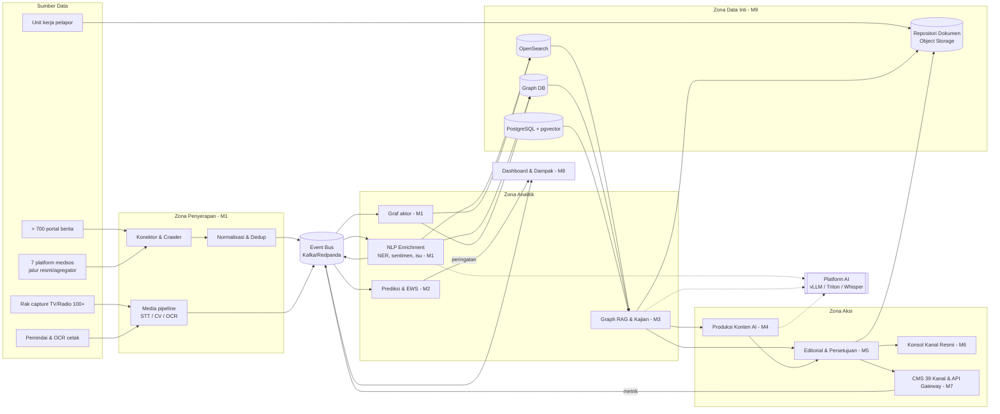
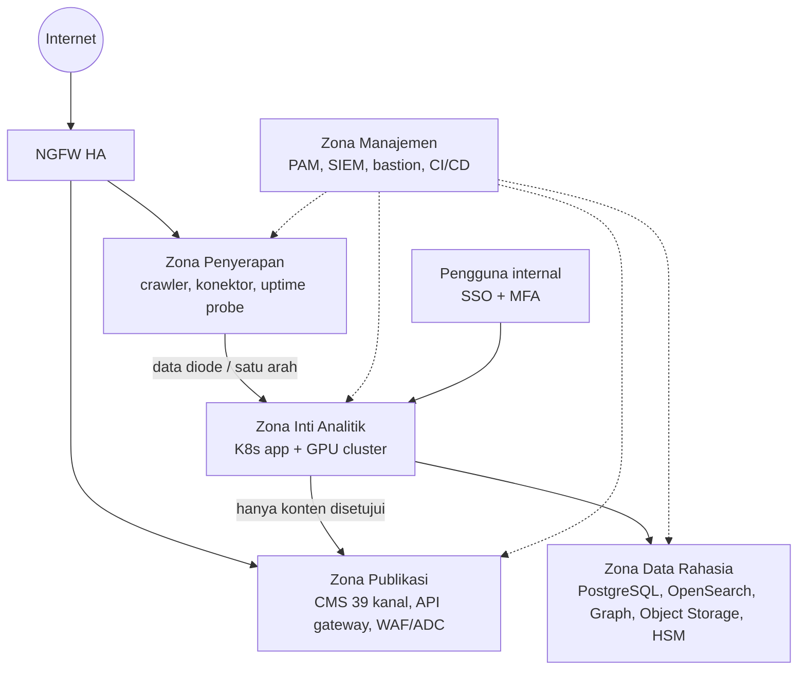
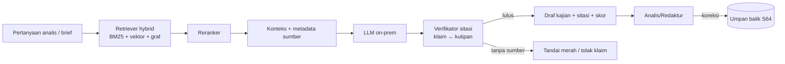

# 03 — Arsitektur Sistem SISTRA

Versi 0.1 · Rujukan: [02-spesifikasi-kebutuhan-srs.md](02-spesifikasi-kebutuhan-srs.md)

---

## 1. Prinsip Arsitektur

1. **Kedaulatan data.** Seluruh komputasi, model, dan data berada *on-premise*. Tidak ada ketergantungan *runtime* ke layanan awan, dan *egress* dibatasi *allow-list*.
2. **Berbasis peristiwa (*event-driven*).** Setiap data masuk menjadi peristiwa di *event bus*. Modul berlangganan topik, bukan memanggil satu sama lain secara langsung, sehingga modul dapat dikembangkan bertahap.
3. **Satu sumber kebenaran per domain.** Tiap layanan memiliki datanya sendiri dan berbagi melalui API atau peristiwa.
4. **Manusia memegang keputusan.** AI menghasilkan draf dan skor; publikasi dan keputusan selalu melalui persetujuan manusia (S33, S36).
5. **Dapat diaudit secara bawaan.** Setiap aksi menghasilkan *audit event* ke log WORM berantai hash (S65).
6. **Perangkat lunak terbuka dan standar.** Prioritas pada komponen *open source* yang matang, untuk menghindari *vendor lock-in*, mendukung TKDN, dan memastikan kode dapat diserahkan.
7. **Zona keamanan.** Komponen dipisahkan ke zona yang berbeda: penyerapan (*internet-facing*), inti analitik, inti data rahasia, dan publikasi.

---

## 2. Arsitektur Logis

### 2.1 Daftar Layanan

| Layanan | Modul/Fitur | Tanggung jawab | Penyimpanan |
|---|---|---|---|
| `ingest-connector` | S01, S02, S05, S06 | Konektor sumber, penjadwal *crawl*, pembatas laju | Kafka |
| `ingest-normalizer` | S03 | Normalisasi, deteksi bahasa, dedup (MinHash) | Redis (indeks dedup) |
| `media-pipeline` | S04, S05 | Segmentasi siaran, STT, CV, OCR | Object storage |
| `nlp-enrichment` | S07–S10, S14 | NER, *geotag*, sentimen, emosi, manipulasi, klasifikasi isu | OpenSearch, PostgreSQL |
| `graph-service` | S11, S12, S13, S19, S58 | Graf aktor dan skor pengaruh | Graph DB |
| `forecast-service` | S16, S17, S20 | Peramalan deret waktu dan skor risiko | PostgreSQL/TimescaleDB |
| `simulation-service` | S18 | ABM | Object storage (hasil) |
| `alert-service` | S21, S22 | Mesin aturan ambang, siklus hidup peringatan, notifikasi | PostgreSQL |
| `rag-service` | S23, S24 | *Retrieval hybrid*, graf pengetahuan, sitasi | OpenSearch, pgvector, Graph DB |
| `report-service` | S25, S61 | Template naskah dinas, ekspor DOCX/PDF/PPTX | Object storage |
| `content-studio` | S26–S33 | Pembuatan teks/multimedia dan agen editorial | PostgreSQL, object storage |
| `workflow-service` | S34–S36, S39 | Kalender, penugasan, *state machine* persetujuan, tanda tangan | PostgreSQL |
| `dam-service` | S37, S38 | Aset digital, lisensi, templat | Object storage, OpenSearch |
| `channel-console` | S40–S45, S48 | Akun resmi, token *vault*, triase komentar | PostgreSQL, Vault |
| `distribution-service` | S49–S53 | CMS *multi-site*, sindikasi, transcoding | PostgreSQL, CDN |
| `api-gateway` | S54 | Gerbang eksternal, *rate limit*, WAF | — |
| `uptime-monitor` | S55 | *Probe* 5 titik | Prometheus |
| `analytics-service` | S56–S59 | Metrik keterlibatan, IEKP | ClickHouse |
| `dashboard-web` | S60, S62, S63 | UI eksekutif dan meja kerja | — |
| `ai-quality` | S64 | Evaluasi model, umpan balik | MLflow |
| `audit-service` | S15, S65 | Log WORM berantai hash | Object storage (*object lock*) |
| `repository-service` | S66–S75 | Dokumen, versi, metadata, klasifikasi, watermark, retensi, portal lapor | PostgreSQL, object storage |
| `identity` | S72, NF-05 | SSO OIDC/SAML, MFA FIDO2, ABAC | Keycloak + OPA |

---

## 3. Tumpukan Teknologi (Rekomendasi)

| Lapisan | Pilihan utama | Alasan |
|---|---|---|
| Orkestrasi kontainer | Kubernetes (RKE2/OpenShift) | Standar industri; *air-gapped* didukung; partisi GPU (MIG) melalui *device plugin* |
| Event bus | Apache Kafka atau Redpanda | Throughput tinggi, retensi peristiwa, *replay* |
| Pemrosesan stream | Apache Flink / Kafka Streams | Agregasi waktu nyata untuk EWS dan metrik |
| Basis data relasional | PostgreSQL 16 (Patroni, aktif–siaga sinkron) + pgvector + TimescaleDB | Matang dan terbuka; satu mesin untuk transaksi, vektor, dan deret waktu |
| Pencarian | OpenSearch (BM25 + k-NN) | Pencarian *hybrid* miliaran dokumen |
| Basis data graf | Neo4j Enterprise atau Memgraph/NebulaGraph | Graf aktor dan Graph RAG |
| Analitik kolumnar | ClickHouse | Metrik keterlibatan bervolume tinggi |
| Object storage | Object storage S3 dengan *object lock* (MinIO/Ceph atau *appliance* setara) | Arsip media dan WORM |
| Cache | Redis/Valkey | Dedup, sesi, *rate limit* |
| *Workflow* | Temporal | Alur panjang (persetujuan, retensi) yang andal dan dapat diaudit |
| Serving LLM | vLLM (dan/atau TensorRT-LLM/Triton) | Throughput tinggi; *open-weight* |
| ASR | Whisper large-v3 (*fine-tuned* Indonesia) via faster-whisper | Akurat, *on-premise* |
| Model NLP | Encoder IndoBERT/XLM-R (klasifikasi), *embedding* multibahasa (bge-m3/e5) | Cepat dan murah dibanding LLM untuk klasifikasi massal |
| LLM | Model *open-weight* 70B-class dan 8B-class yang kuat di Bahasa Indonesia, *fine-tuned* korpus internal | Lihat §5 |
| ML Ops | MLflow (*registry*), Label Studio (anotasi) | Tata kelola model dan data uji |
| Backend | Python (FastAPI) untuk layanan AI/data; Go/Java opsional untuk layanan berbeban tinggi | Ekosistem AI di Python |
| Frontend | React + TypeScript (Next.js), MapLibre (peta), Sigma.js/Cosmograph (graf WebGL) | Modern; graf jutaan *node* |
| Identitas & otorisasi | Keycloak (OIDC/SAML, FIDO2) + Open Policy Agent (ABAC) | Terbuka; kebijakan sebagai kode |
| Rahasia & kunci | HashiCorp Vault/OpenBao + HSM (PKCS#11) | Token OAuth (S40), kunci enkripsi |
| Observabilitas | Prometheus, Grafana, Loki, OpenTelemetry | Pemantauan SLA |
| Keamanan | SIEM (KAK item 49), Falco, Trivy, *image signing* (cosign) | Rantai pasok perangkat lunak |
| CI/CD | GitLab CE *on-premise* + Harbor (*registry*) + Argo CD | *Air-gapped* dan GitOps |

---

## 4. Topologi Penyebaran dan Zona Keamanan

- **Penyerapan → inti** bersifat satu arah (*data diode*/*one-way gateway* bila tersedia). Zona inti tidak dapat diakses dari internet.
- **Inti → publikasi** hanya untuk konten berstatus "Disetujui" (S36) yang ditandatangani. Zona publikasi tidak menyimpan data rahasia.
- Akses administratif hanya melalui PAM dengan *session recording*.

### 4.1 Pemetaan Perangkat Keras KAK ke Beban Kerja

| Perangkat KAK | Peruntukan yang diusulkan |
|---|---|
| 4 server GPU × 8 (32 GPU, ±6 TB VRAM) | **Node 1–2:** serving LLM produksi (generasi, RAG, analisis), 2 replika model besar dan model kecil. **Node 3:** media pipeline (STT 100+ kanal, CV wajah/objek), *embedding*, klasifikasi encoder. **Node 4:** partisi MIG — *fine-tuning*, peramalan, ABM, dan **staging** (temuan J-05). |
| 4 server aplikasi | *Worker node* Kubernetes untuk layanan *stateless* |
| 2 server DB aktif–aktif | PostgreSQL (Patroni) primer + sinkron siaga; disarankan menambah 1 *witness* |
| 4 *search node* | Klaster OpenSearch (3 *master-eligible* + data) |
| SAN 500 TB | Volume PostgreSQL, OpenSearch, Graph DB, Kafka |
| Object storage 2 PB | Media siaran, dokumen, aset DAM, log WORM (*object lock*) |
| Backup 1 PB + tape LTO-9 | Cadangan harian dan arsip dingin (S73) |
| 2 server OCR | Layanan OCR cetak (S05) |
| HSM, SIEM, PAM, SSO | Sesuai §3 |

### 4.2 Estimasi Kapasitas (cek kewajaran)

| Beban | Perhitungan | Hasil |
|---|---|---|
| Unggahan medsos | 5 juta/hari ÷ 86.400 | ±58/dtk rata-rata; puncak ±600/dtk |
| Artikel berita | 50.000/hari | ±0,6/dtk |
| Teks per hari | 5,05 juta × ±2 KB | ±10 GB/hari mentah; ±3,7 TB/tahun |
| Indeks pencarian | ±2–3× teks + vektor 1024-dim (4 KB/dok) | ±25 TB/tahun → SAN 500 TB cukup ±5+ tahun dengan *tiering* |
| Video siaran | 100 kanal × 3 Mbps × 86.400 dtk | ±3,2 TB/hari ≈ 1,2 PB/tahun → **perlu retensi** (J-06) |
| STT siaran | 100 aliran *real-time* | ±4–8 GPU dengan *batching* (faster-whisper) |
| Klasifikasi encoder | Target 1.500 teks/dtk | 1–2 GPU |

Kesimpulan: kapasitas komputasi KAK **memadai bahkan berlebih** untuk analitik teks. Faktor pembatasnya adalah **penyimpanan video** dan **ketersediaan sumber data**, bukan GPU.

---

## 5. Arsitektur AI

- **Pemilihan model:** model klasifikasi berukuran kecil (encoder) untuk volume tinggi; LLM hanya untuk sintesis, generasi, dan kasus sulit.
- **Ketertelusuran (S24):** setiap potongan konteks membawa `source_id`, URL/arsip, cap waktu, dan skor keandalan. Verifikator memeriksa bahwa setiap kalimat memiliki kutipan pendukung (NLI/*entailment*).
- **Registry model:** setiap model memiliki kartu model (data latih, metrik, evaluasi bias, tanggal). Penggantian model melalui persetujuan.
- **Pagar keamanan:** filter keluaran (ujaran kebencian, SARA), label "dibantu AI", dan larangan publikasi otomatis.

---

## 6. Arsitektur Keamanan

| Kontrol | Implementasi |
|---|---|
| Identitas | Keycloak SSO; MFA FIDO2 wajib; sesi berbatas waktu; *step-up auth* untuk dokumen Rahasia ke atas |
| Otorisasi | RBAC (peran §2 SRS) + ABAC via OPA: `clearance ≥ classification ∧ unit ∈ need_to_know ∧ waktu ∈ izin` |
| Enkripsi | TLS 1.3 / mTLS antar-layanan (*service mesh*); AES-256 *at-rest*; *envelope encryption* dengan KEK di HSM |
| Integritas dokumen | SHA-256 per versi; tanda tangan digital persetujuan (S36) dengan kunci di HSM |
| Watermark | Watermark dinamis per unduhan (nama, NIP, IP, waktu) yang tampak dan tersembunyi (S71) |
| Audit | Setiap peristiwa → `audit-service` → rantai hash (`hash_n = SHA256(hash_{n-1} ‖ event_n)`) → object storage *object lock* (WORM); jangkar hash harian ditandatangani HSM |
| Rantai pasok | SBOM per *image*; pemindaian kerentanan; *image* ditandatangani; *registry* internal saja |
| Deteksi | SIEM + UEBA; aturan anomali unduhan (S72) |
| Privasi | Masking PII di jalur analitik umum; data profil (S13) di partisi terpisah dengan otorisasi khusus |

---

## 7. Keputusan Arsitektur (ADR) Ringkas

| ADR | Keputusan | Alternatif yang ditolak | Alasan |
|---|---|---|---|
| ADR-01 | *Event-driven* dengan Kafka | Integrasi *point-to-point* REST | Pemisahan modul, *replay*, dan skala |
| ADR-02 | PostgreSQL + pgvector sebagai DB utama | Basis data vektor terpisah | Mengurangi jumlah sistem; vektor besar tetap di OpenSearch |
| ADR-03 | Encoder untuk klasifikasi massal, LLM untuk sintesis | LLM untuk semua | Biaya komputasi ±50× lebih rendah dan latensi lebih stabil |
| ADR-04 | Temporal untuk alur persetujuan | *State* di tabel saja | Alur panjang, *timeout*, eskalasi, dan audit bawaan |
| ADR-05 | Keycloak + OPA | Otorisasi di kode aplikasi | Kebijakan terpusat yang dapat diaudit |
| ADR-06 | Monorepo, layanan modular | Repositori per layanan | Tim kecil–menengah; konsistensi; CI tunggal |
| ADR-07 | MVP sebagai *modular monolith* (FastAPI) | Mikroservis sejak awal | Validasi alur lebih cepat; batas modul tetap dijaga agar dapat dipecah ke layanan pada F1 |
