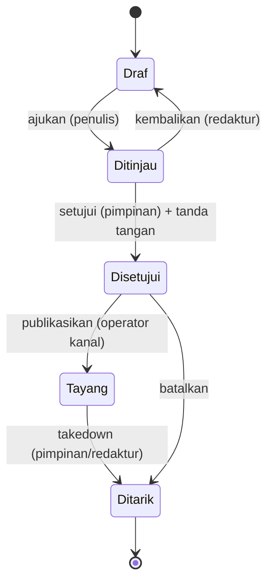

# 04 — Model Data Inti SISTRA

Versi 0.1 · Fokus: entitas inti lintas modul dan entitas MVP. Skema fisik lengkap disusun per layanan pada fase F1.

---

## 1. Diagram Entitas Inti

```mermaid
erDiagram
  SOURCE ||--o{ CONTENT_ITEM : menghasilkan
  CONTENT_ITEM ||--o{ ENTITY_MENTION : memuat
  ENTITY ||--o{ ENTITY_MENTION : disebut
  CONTENT_ITEM }o--o{ ISSUE : diklasifikasi
  ISSUE ||--o{ ISSUE_METRIC : deret_waktu
  ISSUE ||--o{ ALERT : memicu
  ALERT ||--o{ ALERT_EVENT : riwayat
  ISSUE ||--o{ ASSESSMENT : dikaji
  ASSESSMENT ||--o{ CITATION : bersumber
  CITATION }o--|| CONTENT_ITEM : merujuk
  ASSESSMENT ||--o| DOCUMENT : disimpan_sebagai
  DRAFT_CONTENT ||--o{ APPROVAL_STEP : melalui
  DRAFT_CONTENT }o--o{ CHANNEL : didistribusikan
  DOCUMENT ||--o{ DOCUMENT_VERSION : berversi
  DOCUMENT_VERSION ||--o{ DOWNLOAD_LOG : diunduh
  USER }o--|| UNIT : anggota
  USER ||--o{ AUDIT_EVENT : melakukan
  DOCUMENT }o--|| UNIT : dimiliki
```

---

## 2. Kamus Entitas

### 2.1 Penyerapan & Analitik (Modul 1–2)

| Entitas | Atribut kunci | Keterangan |
|---|---|---|
| `source` | id, type (`news`/`social`/`tv`/`radio`/`print`/`report`), name, url, platform, province_code, reliability (A–F), access_basis, active | `access_basis` wajib untuk sumber semi-tertutup (S06) |
| `content_item` | id, source_id, external_id, url, title, body, lang, published_at, ingested_at, author_handle, content_hash, simhash, sentiment_label, sentiment_score, province_code, metrics(jsonb), embedding(vector) | Unit data utama; unik pada (`source_id`, `external_id`) dan `content_hash` |
| `entity` | id, type (`person`/`org`/`location`/`account`), canonical_name, aliases[], wikidata_id | Hasil *entity linking* |
| `entity_mention` | content_id, entity_id, span_start, span_end, confidence | |
| `issue` | id, code, name, taxonomy_path, risk_level, description | Taksonomi isu (S14) |
| `content_issue` | content_id, issue_id, confidence, assigned_by (`model`/`analyst`), corrected_by | Koreksi analis disimpan untuk pelatihan ulang |
| `issue_metric` | issue_id, bucket_start, granularity, volume, sentiment_avg, neg_ratio, province_spread, velocity | TimescaleDB *hypertable* |
| `forecast` | issue_id, horizon_days, generated_at, series(jsonb), ci_low, ci_high, model_version | S16 |
| `alert` | id, issue_id, level (`green`/`yellow`/`orange`/`red`), status (`open`/`ack`/`in_progress`/`resolved`), triggered_at, rule_id, owner_id, reason | S21–S22 |
| `alert_event` | alert_id, at, actor_id, action, note | Riwayat siklus hidup |

### 2.2 Kajian & Produksi (Modul 3–5)

| Entitas | Atribut kunci | Keterangan |
|---|---|---|
| `assessment` | id, title, type (`kajian`/`telaahan`/`nota_dinas`/`paparan`), issue_id, body(jsonb blocks), classification, status, created_by | S25 |
| `citation` | assessment_id, block_id, content_id, quote, confidence, reliability | S24: tiap blok/kalimat → bukti |
| `draft_content` | id, kind (`rilis`/`opini`/`editorial`/`infografis`/`video`/`audio`), title, body, province_code, framing, ai_generated(bool), status, version, created_by | S26–S33 |
| `approval_step` | id, draft_id, from_status, to_status, actor_id, role, at, comment, signature | S36; *append-only* |
| `calendar_entry` | id, draft_id, channel_id, planned_at, assignee_id, status | S34 |
| `channel` | id, code, name, type (`provinsi`/`nasional`/`medsos_resmi`), province_code, url | 39 kanal + akun resmi |

### 2.3 Repositori Pengetahuan (Modul 9)

| Entitas | Atribut kunci | Keterangan |
|---|---|---|
| `document` | id, title, owner_unit_id, classification, period_start, period_end, origin, retention_class, status (`active`/`checked_out`/`archived`/`destroyed`), checked_out_by, tags[] | Metadata wajib S68 |
| `document_version` | id, document_id, version_no, storage_key, sha256, size, mime, created_by, created_at, note | S67; isi berkas disimpan berbasis hash (dedup S66) |
| `download_log` | id, version_id, user_id, ip, at, watermark_id | S71/S72 |
| `access_grant` | id, user_id, document_id/unit_id, permission, valid_from, valid_until, granted_by | Izin berdurasi dan peminjaman antarunit |
| `retention_policy` | class, active_years, inactive_years, final_action (`musnah`/`permanen`) | Mengacu JRA (S73) |
| `report_submission` | id, unit_id, period, report_type, document_id, status, validated_at | S75 |

### 2.4 Identitas & Audit

| Entitas | Atribut kunci | Keterangan |
|---|---|---|
| `unit` | id, code, name, parent_id | Struktur organisasi |
| `user` | id, username, full_name, nip, unit_id, roles[], clearance, active, mfa_enabled | `clearance` ∈ klasifikasi |
| `audit_event` | seq, at, actor_id, action, object_type, object_id, ip, detail(jsonb), prev_hash, hash | S65; `hash = SHA256(prev_hash ‖ canonical_json(event))`; *append-only* |

---

## 3. Klasifikasi & Aturan Akses

| Tingkat | Kode | Nilai urut | Aturan |
|---|---|---|---|
| Terbuka | `TERBUKA` | 0 | Semua pengguna terautentikasi |
| Terbatas | `TERBATAS` | 1 | Clearance ≥ 1 |
| Rahasia | `RAHASIA` | 2 | Clearance ≥ 2 **dan** unit pemilik atau memiliki `access_grant` aktif |
| Sangat Rahasia | `SANGAT_RAHASIA` | 3 | Clearance 3 **dan** `access_grant` eksplisit aktif; *step-up* MFA |

Aturan umum: `boleh_baca = clearance(user) ≥ level(doc) ∧ syarat_tambahan(level)`. Setiap unduhan dicatat dan diberi watermark.

---

## 4. Siklus Status

### 4.1 Persetujuan Konten (S36)

Aturan: penulis tidak boleh menyetujui naskahnya sendiri, dan transisi lain ditolak. Konten `ai_generated = true` wajib melewati status `Ditinjau`.

### 4.2 Peringatan (S22)

`open → ack → in_progress → resolved`, dengan eskalasi otomatis bila tidak ada `ack` dalam batas waktu per level (Merah 15 menit, Oranye 1 jam, Kuning 4 jam).

### 4.3 Dokumen (S67, S73)

`active ⇄ checked_out → active (versi baru) → archived → destroyed` (pemusnahan dengan berita acara).
